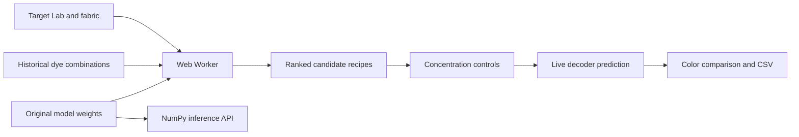

# PigPredict architecture

## Forward model

The source model is `PigPredict_app/resource/keras_model/keras_decoder_model`, a Keras 2.2.0 HDF5 Sequential model. It has ten Dense layers and nine LeakyReLU activations with alpha 0.5:

```text
44 dye concentrations + 3 fabric indicators
                  ↓
47 → 128 → 128 → 128 → 128 → 128 → 128 → 128 → 32 → 16 → 3
                  ↓
normalized L*, a*, b* → original Lab scale
```

Input order comes from `decoder_input_columns.pkl`. Output normalization comes from `lab_mean.pkl` and `lab_std.pkl`:

| Channel | Mean | Standard deviation |
| --- | ---: | ---: |
| L* | 43.77076753246757 | 19.221587662969416 |
| a* | 9.0045077922078 | 20.66339051629358 |
| b* | 1.4475624675324632 | 24.834366085032848 |

`scripts/export_model.py` reads these small metadata pickle files with `pickletools` opcode inspection; it does not execute pickle payloads. It reads model arrays with h5py and writes:

- `model.json`: layer dimensions, offsets, normalization, dye/fabric order and SHA-256 hashes.
- `weights.bin`: 109,923 original float32 parameters in little-endian order, 439,692 bytes.
- `recipes.json`: selected historical color, fabric, dye and concentration records.

JavaScript and NumPy use the same exported weights, with double-precision arithmetic for accumulation. The consistency test independently reads the HDF5 arrays, evaluates every exported recipe, and compares each output channel with an absolute tolerance of `1e-8`. It checks the ported network's numerical behavior, rather than rerunning the obsolete TensorFlow environment.

## Recipe catalog

The exporter reads `hong_make_all_revised_3.csv` and `hong_make_single_revised_3.csv`, matching the original configuration. It excludes aborted records, target-only `-0` records, unsupported fabrics or dyes, missing/non-finite values and concentrations outside the studio's 0–5 range. Repeated `(fabric, Lab, recipe)` records are deduplicated.

The result contains 1,417 records across the three model-supported fabrics. The browser catalog contains only `lab`, `fabric`, `dyes` and `concentrations`; source identifiers and other process fields are not added to the display data.

## Inverse search

The original `core/inverse_decoder.py` uses a TensorFlow graph, random concentration initialization, Adam updates and an average across multiple starting points. The original selector also expands candidate sets with similar single-dye colors.

The interactive version implements a deterministic search suitable for a browser:

1. Filter historical recipes to the chosen fabric and at least two dye channels.
2. Sort by measured Lab distance to the target; select up to eight unique dye combinations.
3. For each combination, use two starts: its historical concentrations and a scaled starting point.
4. Evaluate the original network and backpropagate its analytical Lab Jacobian with respect to the active dye channels.
5. Solve a damped least-squares step. Clamp individual steps to ±0.5 and concentrations to 0–5; accept only improvements in predicted ΔE₇₆.
6. Stop at ΔE₇₆ below 0.005, 45 iterations, or exhausted damping. Keep the best start and rank the candidate recipes.

The model weights, input ordering and normalization are preserved. Candidate selection and inverse optimization are new implementations, so they are described separately from the archived TensorFlow algorithm. A candidate's displayed ΔE₇₆ is the distance between the target and the decoder's prediction for that candidate.

## Application paths



The UI runs the search in a module Web Worker; concentration edits use the decoder in the main thread. Job identifiers reject obsolete worker responses. Target changes mark existing results as stale and disable their export until a new search completes. CSV exports use the currently selected recipe and current edited concentrations.

Django renders `studio.html` and serves the same assets as the static site. The optional `/api/predict/` endpoint validates one to four unique known dye codes, a known fabric and finite concentrations within 0–5. It uses NumPy and retains Django CSRF protection. It performs forward inference, while the browser worker performs inverse recipe search.

The UI does not require the database, TensorFlow, a model-serving service or third-party CDN resources. The original SQLite file is not used by the refreshed runtime; Django administrative data uses `.runtime/db.sqlite3`.

## Display colors

Lab values are converted using a D65 reference white into sRGB and clipped to the screen gamut. The fabric texture is a visual treatment. Model color differences are calculated from Lab values before display conversion, using ΔE₇₆. Dye chips use measured single-dye colors at concentration 1.5 on FVF2429 when available, with a neutral fallback.

## Updating

```bash
# Model/data changes: regenerate the portable model and catalog.
python scripts/export_model.py

# Template or asset changes: refresh the static website.
python scripts/build_demo.py

# Validate before pushing.
python -m pytest tests -q
node --test tests/engine.test.mjs
```

GitHub Actions repeats these checks and verifies that model exports and the generated static site match the committed source.
